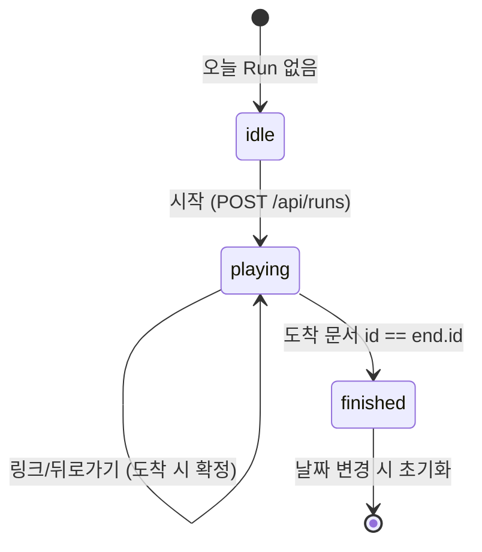

# Linkle 재설계

> 2026-11-19 작성. wikirace(구 링클)의 컨셉과 디자인은 유지하고, 설계와 구현은 처음부터 다시 한다.
> 기존 데이터(Firestore)는 이전하지 않는다.

이 문서는 조사·실험으로 확인한 사실과, 그 위에 세운 설계를 함께 적는다.
확인하지 못한 것은 [10장](#10-확인하지-못한-것)에 따로 모았다.

## 목차

1. [유지하는 것과 버리는 것](#1-유지하는-것과-버리는-것)
2. [전체 구조](#2-전체-구조)
3. [게임 상태와 라우팅](#3-게임-상태와-라우팅)
4. [위키피디아 문서 서빙](#4-위키피디아-문서-서빙)
5. [치팅과 기록의 신뢰도](#5-치팅과-기록의-신뢰도)
6. [유사도와 이모지](#6-유사도와-이모지)
7. [문제 자동 출제](#7-문제-자동-출제)
8. [어제의 기록](#8-어제의-기록)
9. [나무위키 검토](#9-나무위키-검토)
10. [확인하지 못한 것](#10-확인하지-못한-것)
11. [구현 순서](#11-구현-순서)
12. [무한 모드](#12-무한-모드)
13. [위키 문서 검색 입력](#13-위키-문서-검색-입력)
14. [무료 요금제 안에서 운영하기](#14-무료-요금제-안에서-운영하기)
15. [알림 (보류)](#15-알림-보류)

---

## 1. 유지하는 것과 버리는 것

**유지**

- 정체성: 위키피디아 파도타기에 워들의 출제 방식을 더한 게임. 매일 자정(KST) 모두에게 같은 문제, 하루 한 번.
- 로그인 없음.
- 출발·도착 문서는 시작을 누르기 전까지 보이지 않는다.
- 공유 텍스트: 번호, 이동 횟수, 소요 시간, 이모지 배열. 경로는 스포하지 않는다.
- 오늘의 문제에는 실시간 랭킹이 없다. 대신 어제의 기록에서 "언제/어떻게"를 보여준다. 순위표는 무한 모드의 커뮤니티 문제에만 둔다(12.2).
- 디자인: `#3366CC`(하이퍼링크 색), `#F3F7FF`, Pretendard, Rhodium Libre, 파란 바탕 흰 "L" 파비콘, 게임 화면의 고정 Header/Footer.
- 무한 모드. 개발 환경 전용이던 것을 공개 기능으로 올리고, 지난 문제와 커뮤니티 두 파트로 나눈다([12장](#12-무한-모드)).
- 위키 문서 검색 입력. 원리를 옮겨 관리자 화면과 커뮤니티 출제 화면에서 쓴다([13장](#13-위키-문서-검색-입력)).

**버림**

- Next.js, Firebase, OpenAI, EC2 스케줄러, PocketBase 잔재.
- `/ranking` 화면, `/game`·`/success` 라우트와 그 사이의 리다이렉트 가드.
- `path` / `fullPath` / `singlePath` 세 배열과 `moveCount + 1` 오프셋.
- 정규식 기반 HTML 정리, 3단계 퍼지 제목 매칭.
- Ctrl+F 강제 종료.
- `dev/` 평행 구현, 클라이언트 비밀번호 비교 방식의 관리자 인증.

---

## 2. 전체 구조

```
linkle/
├── apps/
│   ├── web/        Vite + React + TypeScript + Tailwind 4 + react-router + zustand
│   └── worker/     Cloudflare Worker: /api/*, Cron, 정적 자산(web/dist) 서빙
├── packages/
│   ├── core/       순수 도메인: 타입, 이동 로그 리듀서, 이모지·공유 문구, KST 날짜
│   ├── wiki/       위키피디아 호출과 문서 정리 규칙 (브라우저·Node 공용)
│   └── embed/      초소형 임베딩 모델의 계산 코드 (브라우저·Node 공용)
├── tools/
│   ├── puzzle-gen/ 문제 후보 생성 스크립트 (오프라인)
│   └── embedding-lab/ 초소형 임베딩 모델 학습 (오프라인)
└── docs/
```

| 역할 | 선택 | 이유 |
|---|---|---|
| 배포 | Worker 하나 + assets 바인딩 | pepero, firework-simulator와 같은 방식 |
| DB | D1 | 문제, 플레이 기록, 통계 |
| 스케줄 | Cron Trigger | 자정 집계와 문제 공개 |
| 유사도 모델 | 직접 만든 2 MB 모델을 브라우저에서 실행 | 서버 호출과 외부 한도가 없다 (6.3) |
| 무거운 예약 작업 | GitHub Actions | 기록 검증과 문제 후보 생성. Worker의 CPU 10 ms 안에 들어가지 않는 일 (14.3) |
| 관리자 인증 | Cloudflare Access | 앱 코드에 인증 로직을 두지 않는다 |

전체가 Cloudflare 무료 요금제 안에서 동작해야 한다. 한도와 그에 맞춘 조정은 [14장](#14-무료-요금제-안에서-운영하기)에 모았다.

`packages/core`와 `packages/wiki`를 나누는 이유는 검증이다.
웹이 문서를 정리할 때 쓰는 규칙과 서버 쪽 검증 작업이 쓰는 규칙이 같은 코드여야 "게임에서 누를 수 있었던 링크"의 정의가 하나로 유지된다.

---

## 3. 게임 상태와 라우팅

### 3.1 원칙

기존 구현의 어려움은 대부분 "진실이 여러 곳에 있었던 것"에서 나왔다.
URL, React 상태, localStorage, 타이머 컨텍스트가 각자 상태를 갖고 서로를 맞추려다 보니 새로고침·재진입·직접 접속마다 경합이 생겼다.

새 설계의 원칙은 다섯 가지다.

1. **이동 로그가 유일한 진실이다.** 경로, 뒤로가기 스택, 이동 횟수, 이모지 입력은 모두 로그에서 계산한다.
2. **화면은 상태의 함수다.** 게임 진행 단계는 URL이 아니라 상태가 정한다.
3. **시간은 서버 시각 두 개로 표현한다.** 흐르는 타이머 값을 저장하지 않는다.
4. **이동은 도착했을 때 확정한다.** 문서를 받아 오는 데 실패한 클릭은 이동이 아니다.
5. **저장 키에는 버전을 붙인다.** 스키마가 바뀌면 이전 버전은 읽지 않고 버린다.

3번과 5번, 그리고 탭 간 동기화는 크릴리온(krillion.io)의 클라이언트를 살펴보고 확인한 방식이기도 하다.
크릴리온은 `krillion:game:v1` 같은 버전 키에 `{runId, date, phase, answerEndsAt, results}`를 저장하고, 서버가 준 `serverNow`로 시계를 보정하며, `visibilitychange`·`pageshow`·`focus`·`storage` 이벤트에서 다시 동기화한다.

### 3.2 상태

```ts
type Page = { id: number; title: string };

type MoveEvent =
  | { type: 'link'; to: Page; via: string; at: number }  // via: 누른 링크의 제목(넘겨주기 전)
  | { type: 'back'; to: Page; at: number };              // at: startedAt 기준 경과 ms

type Puzzle = {
  id: number;
  kind: 'daily' | 'official' | 'community';
  number: number;             // kind별 일련번호
  date: string | null;        // daily만
  start: Page; end: Page;
};

type Run = {
  v: 1;
  mode: 'daily' | 'archive' | 'community';  // 12장
  leads: Record<number, string>;            // 문서 id → "제목: 첫 300자". 유사도 계산용 (6.3)
  puzzle: Puzzle;
  runId: string;
  phase: 'playing' | 'finished';
  startedAt: number;          // 서버 시각
  finishedAt: number | null;
  events: MoveEvent[];
  flags: string[];            // 5장 참고
  emoji: string[] | null;     // 기기에서 계산 (6.3)
  result: { order: number } | null;  // 서버 응답
  outbox: 'none' | 'pending'; // 완료 제출 재시도 여부
};
```

`packages/core`의 순수 함수가 로그에서 나머지를 만든다.

| 파생 값 | 계산 |
|---|---|
| 현재 문서 | 마지막 이벤트의 `to`, 없으면 `start` |
| 뒤로가기 대상 | 로그를 스택으로 재생했을 때 맨 위 바로 아래 |
| 이동 횟수 | `events.length` (뒤로가기 포함) |
| 경로 표시 | `start` + 각 이벤트의 `to.title` |
| 이모지 토큰 | link → 도착 문서의 유사도 색(기기에서 계산), back → ⏪, 마지막 → 🏁 |

### 3.3 단계



- **idle**: 홈. 문제 번호만 보인다. 출발·도착 문서는 서버가 아직 내려주지 않는다.
- **playing**: 게임 화면. 새로고침하거나 탭을 닫았다 와도 로그의 마지막 문서를 다시 받아 그대로 이어진다.
- **finished**: 결과 화면. 공유, 경로, 내 순서.

도착 판정은 제목 문자열이 아니라 **문서 id 비교**다.
넘겨주기를 거친 뒤의 최종 문서 id가 `end.id`와 같으면 클리어다.
블로그 8편의 결론("누른 링크가 아니라 도착한 문서")을 유지하면서, 괄호를 떼고 비교하던 퍼지 매칭이 다른 문서를 정답으로 오인할 가능성을 없앤다.

### 3.4 시간

- 시작: `POST /api/runs` 응답의 `startedAt`과 `serverNow`를 받는다. `offset = serverNow - Date.now()`.
- 표시: `Date.now() + offset - startedAt`. 저장하는 값은 `startedAt` 하나다.
- 같은 날 같은 기기에서 다시 시작을 요청하면 서버는 기존 Run을 돌려준다. "문제를 본 순간부터 타이머가 흐른다"는 기존 규칙이 서버에서 보장된다.
- 종료: 마지막 이벤트의 `at`을 소요 시간으로 쓰되, 서버가 측정한 경과 시간보다 길 수 없고, 차이가 크면 플래그를 단다(5장).

### 3.5 라우팅

| 경로 | 내용 |
|---|---|
| `/` | 오늘의 게임. idle / playing / finished를 상태에 따라 렌더 |
| `/archive` | 무한 모드: 지난 문제 목록 |
| `/archive/:number` | 지난 문제 한 판. idle / playing / finished |
| `/community` | 무한 모드: 커뮤니티 문제 목록 |
| `/community/:id` | 커뮤니티 문제 한 판과 순위표. 공유 링크로도 쓴다 |
| `/community/new` | 출제 (2단계) |
| `/yesterday` | 어제의 기록 |
| `/about` | 크레딧, 업데이트 내역, 라이선스 표기 |
| `/admin` | 문제 큐·신고 관리 (Cloudflare Access 뒤) |

무한 모드에서 URL은 **어떤 문제인지**만 정한다. 그 문제의 진행 단계는 오늘의 게임과 마찬가지로 상태가 정한다.

`/game`과 `/success`가 없으므로 "클리어하지 않은 사람이 클리어 화면에 직접 접속"하는 경우 자체가 사라진다.
게임 안의 뒤로가기는 화면의 버튼이고, 브라우저 히스토리와 연결하지 않는다.
브라우저 뒤로가기로 앱을 떠났다 돌아오면 상태가 그대로 복원된다.

### 3.6 저장과 동기화

| 키 | 내용 |
|---|---|
| `linkle:player:v1` | 익명 기기 id (UUID)와 자동 생성 닉네임 |
| `linkle:run:v1` | 오늘의 Run |
| `linkle:runs:v1` | 무한 모드의 Run. 문제 id별로 보관한다. 끝난 Run은 요약(이동 횟수, 시간, 이모지)만 남긴다 |
| `linkle:stats:v1` | 내 기록: 플레이 수, 연속 일수, 이동 횟수 분포 |

- zustand `persist`로 저장한다. 읽을 때 `puzzle.date`가 오늘(KST)이 아니고 `phase`가 `finished`면 버린다.
- 자정을 넘긴 `playing` Run은 끝까지 풀 수 있다. 결과에는 그날 번호가 찍히고, 집계가 끝난 뒤 제출된 기록은 어제의 기록에 들어가지 않는다.
- 다른 탭이 저장소를 바꾸면 `storage` 이벤트로 다시 읽는다. 두 탭에서 동시에 진행해도 로그는 하나다.
- `visibilitychange`·`pageshow`·`focus`에서 `/api/today`를 다시 확인해 날짜 변경을 감지한다.

### 3.7 이동 한 번의 순서

1. 링크 클릭 → 이동 잠금. 진행 중인 요청이 있으면 무시한다.
2. 문서 요청 (`AbortController`).
3. 성공 → 정리 → `{ type: 'link', to: {id, title}, via, at }`을 로그에 추가 → 렌더 → 잠금 해제.
   이때 문서에서 "제목: 첫 300자"를 뽑아 `leads`에 넣는다(6.3).
   커뮤니티 문제에서는 방문이 3개 쌓일 때마다 서버에 묶어서 알린다(`/api/runs/:id/visit`). 순위표 검증에 쓰는 서버 시각을 남기기 위해서다(5.5). 응답을 기다리지 않고, 실패해도 게임에 영향이 없다. 오늘의 문제와 지난 문제에서는 보내지 않는다.
4. 실패 → 로그는 그대로, 현재 문서 유지, 안내 표시 → 잠금 해제.
5. `to.id === end.id`면 `finished`로 바꾸고, 이모지를 계산하고, 완료를 제출한다. 제출이 실패하면 `outbox: 'pending'`으로 두고 다음 진입 때 재시도한다. 결과 화면은 제출 성공을 기다리지 않는다.

### 3.8 API

| 메서드 | 경로 | 응답 |
|---|---|---|
| GET | `/api/today` | `{ date, number, resetsAt, serverNow, finishedCount }` |
| POST | `/api/runs` | `{ runId, startedAt, serverNow, puzzle: { start, end } }`. 본문 `{ puzzleId? }`, 없으면 오늘의 문제. 오늘의 문제는 기기당 하나, 멱등 |
| POST | `/api/runs/:id/visit` | 204. 본문 `{ visits: { seq, pageId }[] }`. 커뮤니티 문제에서만 보낸다. 서버 시각 기록용 |
| POST | `/api/runs/:id/finish` | `{ order, durationMs }` (멱등). 본문 `{ events, emoji, flags }`. 커뮤니티 문제는 `rank`도 준다 |
| GET | `/api/yesterday` | 집계 결과 |
| GET | `/api/archive` | 지난 문제 목록 `{ number, date, finishedCount }[]`. 출발·도착 없음 |
| GET | `/api/community` | 문제 카드 목록. `sort=new\|popular\|hard`, 커서 페이징 |
| GET | `/api/puzzles/:id` | 문제 카드 하나와 통계. 출발·도착 없음 |
| GET | `/api/puzzles/:id/board` | 순위표 상위와 내 순위 |
| POST | `/api/community` | 출제 (2단계). 본문 `{ startId, endId }`. 검사 후 `draft` 문제와 출제자 Run을 만든다 |
| POST | `/api/puzzles/:id/report` | 신고 (2단계) |

출발·도착 문서는 어느 모드에서든 `POST /api/runs`의 응답으로만 나간다.

### 3.9 D1 스키마

```sql
CREATE TABLE puzzles (                   -- 오늘의 문제와 커뮤니티 문제를 한 표에 둔다
  id          INTEGER PRIMARY KEY,
  kind        TEXT NOT NULL,             -- daily | official | community
  number      INTEGER NOT NULL,          -- kind별 일련번호
  date        TEXT UNIQUE,               -- daily만. KST YYYY-MM-DD
  start_id    INTEGER NOT NULL, start_title TEXT NOT NULL,
  end_id      INTEGER NOT NULL, end_title   TEXT NOT NULL,
  par         INTEGER,                   -- 생성 도구가 확인한 최단 클릭 수 (7장)
  author_id   TEXT,                      -- community만
  author_moves INTEGER,                  -- 출제자가 직접 푼 이동 횟수 (12.2)
  status      TEXT NOT NULL DEFAULT 'published',  -- draft | published | hidden
  plays       INTEGER NOT NULL DEFAULT 0,
  clears      INTEGER NOT NULL DEFAULT 0,
  created_at  INTEGER NOT NULL
);
CREATE UNIQUE INDEX puzzles_number ON puzzles (kind, number);
CREATE UNIQUE INDEX puzzles_pair ON puzzles (start_id, end_id) WHERE kind != 'daily';

CREATE TABLE puzzle_queue (
  id INTEGER PRIMARY KEY,
  start_id INTEGER, start_title TEXT, end_id INTEGER, end_title TEXT,
  par INTEGER,
  status TEXT NOT NULL DEFAULT 'candidate',   -- candidate | approved | rejected | used
  pool   TEXT NOT NULL DEFAULT 'daily'        -- daily | official (12.3)
);

CREATE TABLE players (
  id TEXT PRIMARY KEY, name TEXT NOT NULL, created_at INTEGER NOT NULL  -- name: 자동 생성 닉네임
);

CREATE TABLE runs (
  id          TEXT PRIMARY KEY,
  puzzle_id   INTEGER NOT NULL,
  mode        TEXT NOT NULL,             -- daily | archive | community
  ranked      INTEGER NOT NULL DEFAULT 0, -- 1: 오늘의 문제 당일 Run, 커뮤니티 문제 첫 도전
  player_id   TEXT NOT NULL,
  started_at  INTEGER NOT NULL,
  finished_at INTEGER,
  duration_ms INTEGER,
  moves       INTEGER,
  events      TEXT,                      -- JSON
  visit_log   TEXT,                      -- JSON. 방문 알림에 서버 시각을 붙인 것. community만
  emoji       TEXT,                      -- 클라이언트가 계산한 값. 표시용
  flags       TEXT NOT NULL DEFAULT '',
  finish_order INTEGER,
  verified    INTEGER NOT NULL DEFAULT 0
);
CREATE UNIQUE INDEX runs_ranked_once ON runs (puzzle_id, player_id) WHERE ranked = 1;
CREATE INDEX runs_board ON runs (puzzle_id, moves, duration_ms) WHERE ranked = 1 AND finished_at IS NOT NULL;

CREATE TABLE reports (                   -- 2단계
  puzzle_id INTEGER NOT NULL, player_id TEXT NOT NULL, at INTEGER NOT NULL,
  PRIMARY KEY (puzzle_id, player_id)
);

-- 방문 알림은 행을 따로 만들지 않고 runs.visit_log(JSON, [seq, pageId, 서버 시각][])에 이어 쓴다 (14.3)
-- 문서 임베딩 저장소는 없다. 유사도는 기기에서 계산한다 (6.3)

CREATE TABLE daily_stats (date TEXT PRIMARY KEY, payload TEXT NOT NULL);
```

---

## 4. 위키피디아 문서 서빙

### 4.1 확인한 사실

- 2026년부터 Wikimedia API 전체에 사용자별 요청 제한이 적용된다. 초과하면 429와 `Retry-After`가 온다. ([Rate limits](https://www.mediawiki.org/wiki/Wikimedia_APIs/Rate_limits))

  | 구분 | 제한 (분당) |
  |---|---|
  | IP 외에 식별 정보가 없는 요청 | 10 |
  | 웹 브라우저에서 온 비로그인 요청 | 200 |
  | 연락처가 담긴 User-Agent를 보내는 봇 | 200 |

  동시 요청은 3개 이하가 권장된다. 실험 스크립트가 요약 9개를 한꺼번에 요청했다가 실제로 429를 받았다.
- `https://ko.wikipedia.org/w/rest.php/v1/page/{제목}/html`은 Parsoid HTML을 돌려주고 `Access-Control-Allow-Origin: *`이다. "불고기" 문서로 확인한 구조:
  - 섹션이 `<section data-mw-section-id="9">`로 감싸져 있다. "같이 보기"는 9번, "각주"는 10번 섹션이었다.
  - 내부 링크는 `<a rel="mw:WikiLink" href="./쇠고기" title="쇠고기">` 형태다.
  - 넘겨주기 링크는 `class="mw-redirect"`, 동음이의 문서 링크는 `class="mw-disambig"`, 없는 문서 링크는 `class="new"`다.
  - `<head>`에 `mw:pageId`, `mw:pageNamespace` 메타가 있다.
  - 링크 301개 중 97개가 `.navbox` 안에 있었고, 없는 문서 링크가 38개, `특수:`·`틀:`·`틀토론:` 링크가 8개였다.

### 4.2 누가 위키피디아를 호출하는가

**브라우저가 직접 호출한다.** Worker는 중계하지 않는다.

지난번에는 Worker 중계를 권했지만 요청 제한을 확인하고 결론을 바꿨다.
브라우저는 사용자마다 분당 200회를 쓸 수 있고, Worker는 모든 사용자가 분당 200회를 나눠 써야 한다.
직접 호출은 사용자가 늘어도 한도가 함께 늘어난다.

서버 쪽에서 위키피디아를 호출하는 것은 기록 검증과 문제 후보 생성뿐이고, 둘 다 Worker가 아니라 예약 작업이 한다(14.3).
이때는 연락처가 담긴 User-Agent를 쓰고, 동시 요청 3개 이하, `Retry-After`를 지킨다.

### 4.3 문서 정리

정규식 대신 DOM 구조에 선언적 규칙을 적용한다. 규칙은 `packages/wiki`의 한 객체에 모은다.

```ts
export const policy = {
  dropSections: ['같이 보기', '각주', '외부 링크', '참고 문헌', '주해', '출처'],
  dropSelectors: [
    '.navbox', '.hatnote', '.dablink', '.ambox', '.sistersitebox', '.metadata',
    '.mw-references-wrap', 'sup.reference', '.mw-editsection', '.noprint', 'audio',
  ],
  link: {
    requireRel: 'mw:WikiLink',
    mainNamespaceOnly: true,   // 특수:, 틀:, 분류:, 파일:, 위키백과: 등 제외
    allowMissing: false,       // class="new"
    allowDisambiguation: true, // 결정 필요
    blockedTitles: [],         // 허브 문서 정책, 결정 필요 (5.1)
  },
} as const;
```

정리 순서:

1. HTML을 Document로 파싱한다. 브라우저는 `DOMParser`, Node(예약 작업)는 같은 DOM API를 제공하는 파서를 쓴다.
2. 제목이 `dropSections`에 있는 `section`을 통째로 제거한다.
3. `dropSelectors`에 해당하는 요소를 제거한다.
4. 링크를 다시 쓴다. 규칙을 통과한 링크는 `href`를 없애고 `data-title`만 남긴다. 통과하지 못한 링크는 글자만 남긴다.
5. 이미지를 감싼 파일 링크를 벗긴다.
6. `{ id, title, html }`을 돌려준다.

`href`를 없애는 것이 핵심이다.
길게 눌러 새 탭으로 열기, 가운데 클릭, 링크 주소 복사, 드래그로 게임 밖 위키피디아에 나가는 길이 한 번에 막힌다.
기존 구현은 `/wiki/`로 시작하는 모든 링크를 허용해서 `파일:`·`특수:` 문서로도 이동할 수 있었다.

### 4.4 렌더

- 정리한 HTML을 Shadow DOM 안에 넣는다. 위키피디아 스타일과 앱의 Tailwind 스타일이 서로 영향을 주지 않는다.
- 위키피디아 본연의 문서 모습을 위해 위키피디아의 스타일시트를 Shadow DOM 안에서 불러온다.
- 클릭은 `data-title`에 대한 이벤트 위임으로 처리한다.
- 방문한 문서는 메모리에 보관한다. 뒤로가기는 다시 요청하지 않는다.
- 문서 하단에 원문 링크와 CC BY-SA 4.0 표기를 둔다. 게임 중에는 누를 수 없고 결과 화면에서 활성화한다.

---

## 5. 치팅과 기록의 신뢰도

로그인이 없으므로 "같은 사람이 다른 창에서 미리 풀어 보는 것"은 원리적으로 막을 수 없다.
막을 수 없는 것을 막으려다 정상 플레이를 깨뜨리는 대신, 막을 수 있는 것은 구조로 막고 나머지는 기록에서 걸러 낸다.

### 5.1 경로의 공정성 (구조로 막는다)

| 사기적인 길 | 대응 |
|---|---|
| 하단 탐색 상자 | `.navbox` 제거 |
| 같이 보기, 각주, 외부 링크 | 섹션 단위 제거 |
| 상단 안내문(다른 뜻, 동음이의) | `.hatnote`, `.dablink` 제거 |
| 분류, 틀, 특수, 파일 문서 | 일반 문서 이름공간만 허용 |
| 없는 문서 | 링크 해제 |
| 게임 밖 위키피디아로 나가기 | `href` 제거 |

정책으로 정할 것이 두 가지 남는다.

- **동음이의 문서**: 링크 묶음이라 지름길이 될 수 있다. `mw-disambig` 클래스로 식별된다.
- **허브 문서**: "대한민국", "2024년", "1월 1일"처럼 어디서나 닿고 어디로나 가는 문서. 연도·날짜 문서는 제목 패턴으로, 나머지는 역링크 수 상위 목록으로 식별할 수 있다. 막으면 게임이 어려워지고, 두면 경로가 단조로워진다. 문제 생성 도구가 만든 데이터를 보고 정하는 것이 좋다.

### 5.2 페이지 내 검색

Ctrl+F 감지는 버린다. 모바일의 "페이지에서 찾기"는 감지할 수 없고, 데스크톱에서는 오탐이 정상 플레이를 끝내 버린다.

대신 **실격이 아니라 표시**로 바꾼다.
검색 단축키 입력, 긴 시간 탭 이탈 같은 신호를 Run의 `flags`에 남긴다.
플래그가 있어도 게임은 끝까지 진행되고 공유도 된다. 어제의 기록 후보에서만 빠진다.

### 5.3 기록의 무결성 (서버가 본다)

| 위조 | 대응 |
|---|---|
| 시간을 줄여 제출 | 서버가 `startedAt`을 갖고 있다. 제출된 시간은 서버가 잰 경과 시간보다 길 수 없고, 이동 횟수 × 최소 시간보다 짧을 수 없다 |
| 가짜 경로 제출 | 로그의 형식을 검사한다: 첫 이동의 출발이 `start`, 마지막이 `end`, 시각이 단조 증가 |
| 여러 번 제출 | `(puzzle_id, player_id)` 유일 제약. 기기당 첫 Run만 기록 |
| 통계에 노출될 기록 조작 | 자정 집계 때 후보 기록만 실제로 검증한다 (8장) |

전수 검증은 하지 않는다. 화면에 나갈 기록 몇 개만 검증하면 하루 수십 번의 위키피디아 호출로 끝난다.

### 5.4 남는 한계

시크릿 창에서 미리 풀고 본 창에서 빠르게 다시 푸는 것은 막지 못한다.
그래서 어제의 기록은 극단값 하나보다 분포(이동 횟수 분포, 시간 중앙값)를 함께 보여 주고, 최단 경로는 "누가"가 아니라 경로 자체로 가치가 있으므로 미리 풀었더라도 정보로서 유효하다.

### 5.5 커뮤니티 순위표

오늘의 문제에 랭킹을 두지 않은 이유(어뷰징)는 커뮤니티 순위표에도 그대로 적용된다.
순위표는 "누가"를 보여 주므로 조작할 동기가 더 크다. 대책은 네 가지다.

| 조작 | 대응 |
|---|---|
| 시간을 줄여 제출 | 순위에 쓰는 시간은 클라이언트가 보낸 값이 아니라 **서버가 잰 값**(완료 제출을 받은 시각 − `startedAt`)이다 |
| 가짜 경로 제출 | 순위표 상위에 들어갈 기록은 제출 때 8장과 같은 방식으로 한 걸음씩 검증한다. 방문 알림(`runs.visit_log`)에 서버 시각이 찍혀 있어, 경로를 한꺼번에 지어내면 시각이 맞지 않는다 |
| 답을 아는 사람의 기록 | 출제자 본인 제외. 첫 도전만 순위에 반영 |
| 기기 id를 새로 만들어 다시 도전 | 막지 못한다. 순위의 첫 기준이 이동 횟수라, 얻는 것은 "최단 경로를 아는 사람의 빠른 손" 정도로 제한된다 |

마지막 줄이 남는 한계다. 로그인이 없는 한 문제별 순위표의 상단은 "처음 푼 사람의 실력"이 아니라 "가장 잘 준비한 기록"에 가까워진다.
그래서 여러 문제의 성적을 합치는 전체 순위는 두지 않는 것을 권한다(12.4). 조작이 쌓이는 구조가 되기 때문이다.

검증은 위키피디아 호출을 쓴다. Worker의 한도는 모든 사용자가 나눠 쓰므로(4.2), 검증 대상은 순위표 상위에 들어가는 기록으로만 한정한다.

---

## 6. 유사도와 이모지

### 6.1 실험

목표 문서 4개와 경로 문서 29개로 세 모델을 돌렸다. 입력은 "제목"과 "제목 + 첫 문단 300자" 두 가지였다.

| 모델 | 내려받는 크기 | 문서 9개 임베딩 (M 시리즈 CPU) | 결과 |
|---|---|---|---|
| multilingual-e5-small (int8) | 118 MB | 약 150 ms | 순서는 맞음. 값이 0.73~0.89에 몰림 |
| EmbeddingGemma 300m (q4) | 197 MB | 약 500 ms | 순서 맞음. 값이 0.26~0.68로 넓게 퍼짐 |
| potion-multilingual-128M (정적 임베딩) | 506 MB (전체 어휘) | 약 1 ms | 순서가 군데군데 틀림 |

EmbeddingGemma, "제목 + 첫 문단" 입력, 목표 "뉴발란스" (블로그 6편의 예시):

| 문서 | 코사인 | 0.27~0.65를 0~1로 편 값 | 이모지 |
|---|---|---|---|
| 불고기 | 0.304 | 0.09 | 🟥 |
| 소고기 | 0.320 | 0.13 | 🟥 |
| 소 | 0.327 | 0.15 | 🟥 |
| 가죽 | 0.390 | 0.32 | 🟧 |
| 의류 | 0.436 | 0.44 | 🟨 |
| 패션 | 0.448 | 0.47 | 🟨 |
| 신발 | 0.528 | 0.68 | 🟩 |
| 나이키 | 0.682 | 1.00 | 🟦 |

알게 된 것:

- **제목만으로는 안 된다.** 목표 "세종"에서 제목만 넣으면 "대한민국"·"서울특별시"가 "훈민정음"보다 높게 나왔다. 첫 문단을 넣으면 훈민정음·조선·한글이 위로 올라온다. 블로그에서 우려한 문제가 그대로 재현됐고, 첫 문단으로 해결된다.
- **값을 그대로 쓸 수 없다.** 모델마다 값의 범위가 다르므로 하한·상한을 정해 0~1로 편 뒤 5단계로 나눠야 한다.
- **한계도 보인다.** 같은 설정에서 목표 "세종"에 대해 "이순신"이 0.92(🟦)로 나왔다. 같은 조선 시대 인물이라는 점이 크게 반영된 결과다. 20% 단위라는 표현 방식이 이런 오차를 어느 정도 덮지만, 보정 구간은 더 많은 예시로 정해야 한다.

### 6.2 기기에서 돌릴 수 있는가

기술적으로는 된다. e5-small은 브라우저에서 돌아가는 형식(ONNX)이 있고 추론도 충분히 빠르다.

문제는 크기다.
다국어 임베딩 모델은 어휘 테이블이 커서, 가장 작은 것도 내려받는 파일이 106~118 MB다(bekko a8m 106 MB, e5-small 118 MB).
모바일에서 공유 버튼 하나를 위해 100 MB를 받게 하는 것은 "가볍고 진입 장벽 낮은 웹 게임"과 맞지 않는다.
기존 모델을 그대로 쓰는 한 그렇다. 한국어 위키백과에 맞춰 직접 만든 모델은 2 MB로 줄일 수 있었고(14.6), 6.3은 그 모델을 쓴다.

크릴리온도 확인했다. 기기에서 모델을 돌리지 않는다.
답안 채점은 `/api/submit`으로 서버에 보내고, 클라이언트 번들에 ONNX·WebGPU·임베딩 관련 코드는 없었다.
크릴리온에서 참고할 것은 유사도 계산이 아니라 3장의 상태 관리 방식이다.

### 6.3 선택

**2 MB짜리 초소형 모델을 브라우저에서 돌린다. 서버는 유사도 계산에 관여하지 않는다.**

처음에는 Workers AI에서 임베딩을 만들고 서버에 저장하는 방식을 골랐다. 14.6의 실험에서 2 MB 모델이 큰 모델과 한 칸 이내 96%로 일치하는 것을 확인하고 바꿨다. 이전 방식은 6.3.1에 검토 기록으로 남긴다.

**모델**

- 단어 조각마다 벡터를 하나씩 외워 두고 더하는 방식이다. 어휘 1.6만 개 × 128차원, 차원당 1바이트로 2.0 MB, 어휘 파일 0.3 MB.
- `tools/embedding-lab`에서 학습하고, 결과 파일을 `apps/web`의 정적 파일로 배포한다. 정적 파일 요청은 무료이고 횟수 제한이 없다(14.1).
- 계산 코드는 `packages/embed`에 둔다. 토큰 나누기, 벡터 합, 보정, 색 구간까지 순수 TypeScript다. 브라우저와 Node(어제의 기록 집계)가 같은 코드를 쓴다.
- 파일 이름에 버전을 넣는다(`embed-v1`). 같은 버전이면 누가 계산해도 같은 문서에 같은 색이 나온다.

**흐름**

1. 게임을 시작하면 모델 파일을 뒤에서 받는다. 게임 진행을 막지 않는다. 한 번 받으면 브라우저 캐시에 남는다.
2. 문서에 도착할 때마다, 이미 받은 문서에서 "제목: 첫 300자"를 뽑아 Run에 저장한다(`leads`). 위키피디아를 다시 호출하지 않는다.
3. 도착 문서에 닿으면 저장해 둔 문단들을 한꺼번에 계산한다. 문서 하나에 0.1 ms 수준이라 결과 화면과 동시에 이모지가 나온다. 네트워크가 끊겨 있어도 된다.
4. `packages/core`가 색을 ⏪·🏁와 함께 공유 문구로 조립한다.

벡터가 아니라 문단을 저장하는 이유는 두 가지다. 모델을 다 받기 전에 지나간 문서도 나중에 계산할 수 있고, 모델 버전이 바뀌어도 저장 형식이 그대로다. 한 판에 3 KB 안팎이다.

**달라지는 것과 그대로인 것**

- 방문 알림은 유사도에 더 이상 필요 없다. 커뮤니티 순위표의 검증 자료로만 남는다(5.5).
- 서버에 벡터 저장소가 없다. Workers AI 한도에 기대지 않는다.
- 게임 중에는 화면에 점수를 보여 주지 않는다. 힌트가 되지 않게 하려는 원칙은 그대로다. 다만 계산이 기기에서 일어나므로 마음먹은 사람이 직접 계산해 보는 것까지 막지는 못한다. 도착 문서를 아는 사람은 지금도 다른 도구로 같은 일을 할 수 있다.
- 이모지는 클라이언트가 만든다. 조작해서 공유할 수 있지만 이모지는 순위나 기록에 쓰이지 않는다. 서버는 완료 제출에 실려 온 이모지를 표시용으로만 저장한다.
- 어제의 기록에 나가는 최단 경로의 색은 집계 작업이 `packages/embed`로 다시 계산한다.

유사도 계산은 여전히 `score(target, pages) → number[]` 한 함수 뒤에 둔다.

**구현 전에 할 일**

- 브라우저용 토큰 나누기가 학습에 쓴 파이썬 구현과 같은 결과를 내는지, 고정 예시로 테스트한다.
- 게임에서 실제로 뽑는 문단 형식으로 보정 계수를 다시 구한다. 학습 문단은 덤프에서 뽑은 것이라 형식이 조금 다르다.
- 예시를 사람 눈으로 본다. 14.6은 큰 모델과의 일치만 쟀다.
- 여유가 되면 전체 문서로 다시 학습한다. 기준 벡터를 만드는 데 로컬에서 몇 시간이 든다.

### 6.3.1 다른 선택지와 비용 (검토 기록)

기기 계산으로 바꾸기 전에 비교한 서버 쪽 방식들이다. 초소형 모델의 품질이 부족하다고 판단되면 여기로 돌아온다.

문서 하나의 입력을 첫 문단 약 150토큰으로 잡은 값이다. Cloudflare 가격은 2026-11-19에 공식 문서에서 확인했고, OpenAI 가격은 2차 자료 기준이다(10장).

| 방식 | 단가 | 문서 1만 개 | 다음 날 재사용 | 비고 |
|---|---|---|---|---|
| Workers AI 임베딩 (bge-m3, qwen3-embedding-0.6b) | 입력 100만 토큰당 $0.012 | 약 $0.02 | 가능 | 외부 키 없음. 하루 10,000 뉴런 무료(문서 약 6만 개 분량) |
| OpenAI 임베딩 (text-embedding-3-small) | 입력 100만 토큰당 $0.02 | 약 $0.03 | 가능 | 외부 키와 결제 계정 필요 |
| OpenAI Decisions API (gpt-6-luna) | 입력 100만 토큰당 $0.10, 출력 무료 | 약 $0.5 이상 | 불가 | 문서 쌍마다 채점 기준과 두 문단을 함께 보내야 한다 |
| Cloudflare Containers에 직접 띄운 모델 | 쓴 시간만큼 (아래) | - | 가능 | 원하는 모델을 고를 수 있다 |
| 임베딩 서버 직접 운영 | 서버 상시 비용 | - | 가능 | 아래 참고 |

**Cloudflare 안에서 직접 띄울 수 있는가**

- **Worker 안에서는 안 된다.** Worker 하나가 쓸 수 있는 메모리가 128 MB이고 코드 묶음은 64 MiB까지다. 실험한 모델 중 가장 작은 것이 118 MB라 들어가지 않는다.
- **Workers AI가 그 역할을 한다.** Cloudflare가 모델을 대신 띄워 주고 호출한 만큼만 받는다. 임베딩 모델 목록에 bge-m3, qwen3-embedding-0.6b, embeddinggemma-300m(베타, 가격표에 없음)이 있다. multilingual-e5는 없다.
- **모델을 직접 고르고 싶으면 Containers다.** Worker에 컨테이너를 붙이는 기능이고 Workers Paid 요금제에서 쓴다. 요청이 없으면 잠들고 그동안은 과금되지 않는다. 메모리 1 GiB짜리(`basic`)를 한 달 내내 켜 두면 메모리 요금만 약 $6.5이고, 월 25 GiB·시간까지는 요금제에 포함된다. 깨어나는 데 걸리는 시간은 문서에 없다.
- Containers는 유료 요금제(월 $5)가 필요하므로 **쓰지 않는다**. 운영비 0원이 조건이다. Workers AI의 무료 한도로 시작하고, 그것이 부족해질 때의 대안은 14.4에 적었다. 어느 쪽이든 `score` 함수 뒤에서 바꾸므로 나머지는 그대로다.

- **비용은 어느 쪽이든 문제가 되지 않는다.** 하루 수천 명이 해도 임베딩은 몇 센트다. 선택 기준은 운영 부담과 품질이다.
- **Decisions API는 품질 대안이다.** 임베딩은 "같은 시대 인물"처럼 주제가 겹치면 높게 나오는 한계가 있었다(6.1). 판단형 모델은 이런 경우를 더 잘 가릴 가능성이 있다. 다만 결과가 문서 쌍 단위라 다음 날 재사용할 수 없다. 보정 실험에서 임베딩 품질이 부족하면 `score` 구현만 바꿔 넣는다.
- **임베딩 서버를 직접 띄우는 것은 어렵지 않지만 필요가 없다.** e5-small은 CPU에서 문서 하나에 약 17 ms라, 작은 서버 하나로 초당 수십 건을 처리한다. 동시성은 요청을 묶어 처리하면 된다. 그러나 서버가 항상 켜져 있어야 하고, 캐시 덕분에 실제 호출은 드물다. 호출한 만큼만 내는 쪽이 맞다.

### 6.4 서버 계산으로 되돌릴 조건

- 사람 눈으로 본 예시에서 초소형 모델의 색이 납득되지 않는 경우가 많을 때.
- 그때는 `score`의 구현을 Workers AI 임베딩으로 바꾼다. 문서에 도착할 때 서버가 미리 임베딩해 두고 완료 응답에 색을 실어 보내는 방식이며, 무료 한도(하루 약 6만 문서) 안에서 돈다. 벡터는 문서 단위로 영구 저장해 재사용한다.
- 나머지 코드는 그대로다. 바뀌는 것은 방문 알림을 모든 모드에서 보내는 것과 벡터 저장 DB가 생기는 것이다.

---

## 7. 문제 자동 출제

### 7.1 좋은 문제의 조건

- 두 문서 모두 많은 사람이 아는 주제다.
- 게임 규칙(4.3) 안에서 도달할 수 있다.
- 너무 쉽지도 어렵지도 않다. 최단 3~5번 클릭.
- 출발과 도착이 직접 연결되어 있지 않고, 주제가 충분히 떨어져 있다.
- 동음이의·목록·연도·날짜 문서가 아니다.
- 최근의 사고, 사망, 정치적 논쟁처럼 게임 소재로 부적절한 주제가 아니다.

### 7.2 방식

**오프라인 도구가 후보를 만들고, Cron이 매일 하나씩 공개한다.**

1. `tools/puzzle-gen`이 한국어 위키백과의 조회수 상위 문서 목록에서 후보 문서를 뽑는다.
2. 후보 쌍마다 실제 게임 규칙으로 정리한 문서를 따라 너비 우선 탐색을 해서 최단 클릭 수(par)를 구한다. 탐색 깊이와 호출 수에 상한을 두고, 요청 제한을 지킨다.
3. par가 범위 안이고 조건을 통과한 쌍을 `puzzle_queue`에 `candidate`로 넣는다.
4. `/admin`에서 후보를 훑어보고 승인하거나 버린다. 승인 없이 자동 공개하는 설정도 둔다.
5. Cron이 매일 자정 직전에 승인된 후보 하나를 `puzzles`로 옮긴다. 큐가 7일치 아래로 줄면 알린다.

런타임(Worker)에서 문제를 즉석 생성하지 않는 이유는 요청 제한과 검수다.
탐색에는 위키피디아 호출이 많이 필요하고, 공개 전에 한 번 볼 기회가 있어야 부적절한 문제를 거를 수 있다.

par는 게임에도 쓸 수 있다. 결과 화면에 "최단 3번, 나는 5번"을 보여 주면 익명 랭킹 없이도 자기 기록을 평가할 기준이 생긴다.

---

## 8. 어제의 기록

매일 00:05 KST에 전날을 집계한다.
분포 계산(4번)과 저장은 Worker의 Cron Trigger가 하고, 문서를 받아 정리해야 하는 검증(2번)은 GitHub Actions 예약 작업이 한다. Worker 무료 요금제의 CPU 10 ms 안에 문서 파싱이 들어가지 않기 때문이다(14.3).

1. 플래그 없는 완료 기록에서 최단 경로 후보와 최단 시간 후보를 몇 개씩 뽑는다.
2. 후보의 로그를 한 걸음씩 검증한다. 각 이동에 대해 출발 문서를 받아 `packages/wiki`로 정리하고, 그 안에 `via` 링크가 있는지, 그 링크가 `to.id`로 이어지는지 확인한다.
3. 검증을 통과한 첫 후보를 기록으로 확정한다.
4. 분포를 계산한다: 완료 인원, 이동 횟수 분포, 시간 중앙값.
5. 최단 경로의 색을 `packages/embed`로 계산한다. 각 문서의 "유사도 이유 한 문장"은 Workers AI의 텍스트 모델로 한 번 생성한다(하루 몇 문장이라 무료 한도 안이다. 없어도 되는 기능이다).
6. `daily_stats`에 저장한다.

클라이언트는 `/api/yesterday`만 읽는다. 집계가 아직이면 "집계 중"을 보여 준다.

---

## 9. 나무위키 검토

결론: **링클에는 넣지 않는 것을 권한다.** 웹 게임으로 만드는 길은 열려 있지만 조건이 나쁘다.

확인한 사실:

- 라이선스는 CC BY-NC-SA 2.0 KR이다. 비영리, 출처 표시, 동일 조건 변경 허락이 조건이다.
- 공식 API가 없다. 공식 DB 덤프는 더 이상 배포되지 않는다는 커뮤니티 글이 있다(공식 발표는 찾지 못했다).
- `namu.wiki/robots.txt`는 `/w/`(문서 보기)를 허용한다. 다만 나무위키 측이 미러 사이트의 수집을 여러 차례 차단했다는 기록이 있다.
- 이미 같은 컨셉의 게임이 있다.
  - [나무타기](https://github.com/L4N14KE4/namu-tagi): 크롬 확장. 나무위키 사이트 위에서 직접 동작한다. 오늘의 문제, 난이도, 하드 모드(틀 상자·허브 문서 금지), 도전장 링크, 탭 이탈 실격까지 갖췄고 "판매하거나 수익을 얻지 않습니다"라고 명시한다.
  - 웹으로 서비스되는 "나무위키 게임"도 하나 있다.

방식별 | 방식 | 판단 |
|---|---|
| 문서를 가져와 우리 서버에서 보여 주기 | 비영리·출처 표시·동일 조건을 지키면 라이선스상 가능해 보인다. 그러나 API가 없어 HTML을 긁어야 하고, 운영 측이 차단하면 서비스가 멈춘다. 광고를 붙일 수 없다. 대량 수집은 데이터베이스 제작자의 권리 문제도 있다 |
| iframe | 다른 출처의 문서 안을 관찰할 수 없어 게임 진행을 추적할 수 없다 |
| 브라우저 확장 | 콘텐츠를 재배포하지 않아 가장 깨끗하다. 그러나 데스크톱 크롬에서만 동작해 모바일을 잃고, 나무타기가 이미 잘 만들어져 있다 |

법률 판단이 필요한 부분은 변호사에게 확인해야 한다. 위 내용은 공개된 라이선스 문구와 사이트 설정을 읽은 것이다.

설계에는 영향을 주지 않는다. `packages/core`는 문서 id와 제목만 다루고 위키피디아를 모른다.
나중에 다른 위키를 붙이게 되더라도 바꿀 곳은 `packages/wiki`뿐이다.

---

## 10. 확인하지 못한 것

구현하면서 확인된 것(2026-11-19):

- **넘겨주기**: `rest.php`의 HTML 주소는 넘겨주기 제목에 307로 최종 문서 주소를 알려 주고, 브라우저의 fetch가 그대로 따라간다. 받은 문서의 머리 부분에 최종 문서의 id와 제목이 있다. "프리메라리가" 링크로 "라리가" 문서에 도착하는 것을 게임에서 확인했다.
- **Shadow DOM과 위키백과 스타일**: 문서 머리 부분의 스타일시트 주소를 Shadow DOM 안에서 불러오면 정보 상자와 표, 제목이 위키백과와 같은 모습으로 나온다.
- **브라우저에서의 모델 실행**: 데스크톱 브라우저에서 모델 파일을 받아 이모지를 계산했다. 모바일 실제 기기에서는 아직 확인하지 않았다.

아직 확인하지 못한 것:

- Workers AI 제공 모델의 품질. 지금은 대안(6.4)일 뿐이라 급하지 않다. bge-m3, qwen3-embedding-0.6b, embeddinggemma-300m을 같은 예시로 돌려 보지 않았다.
- Cloudflare Containers가 깨어나는 데 걸리는 시간.
- 초소형 모델(14.6)이 사람이 보기에도 맞는지. 큰 모델과의 일치만 쟀다.
- 초소형 모델을 브라우저에서 돌린 적이 없다. 모바일에서 모델 파일(전송 크기 약 2 MB)을 받고 푸는 시간이 얼마인지. TypeScript 구현이 파이썬과 같은 결과를 내는 것은 `packages/embed`의 테스트로 확인했다(예시 193개의 토큰·벡터·유사도). 다만 학습 쪽 라이브러리가 모르는 최신 문자(새 이모지 등)는 두 구현이 다르게 처리할 수 있다.
- 게임에서 뽑는 문단(Parsoid HTML의 첫 문단)과 학습 문단(덤프의 본문 앞부분)의 형식 차이가 색에 주는 영향. 보정 계수를 다시 구해야 한다.
- Worker에서 위키피디아 문서를 파싱할 때의 CPU 시간. 10 ms를 넘을 것으로 보고 설계했지만 측정하지 않았다(14.3).
- 14.3의 한 판당 쓰기 수가 실제 서비스에서도 로컬 측정값(6~8행)과 같은지. 커뮤니티 문제의 쓰기 수는 아직 재지 않았다.
- Worker의 요청당 실제 CPU 시간. 배포하지 않아 재지 못했다.
- `puzzles.plays`(도전 수)는 아직 올리지 않는다. 커뮤니티 목록을 만들 때(구현 순서 9번) 넣는다.
- GitHub Actions 무료 한도(비공개 저장소 월 2,000분)와 예약 작업의 실행 시각 정확도.
- 무료 요금제에서 기기별 요청 제한을 거는 방법(Workers의 요청 제한 기능이 무료에서 되는지).
- 커뮤니티 순위표의 조작 대책(5.5)이 실제로 충분한지. 1단계에서 링클 출제 문제로 먼저 확인한다.
- 유사도 보정 구간. 6.1의 0.27~0.65는 목표 4개, 문서 29개에서 눈으로 잡은 값이다.
- 6.3.1의 가격. OpenAI Decisions API(2026년 10월 공개)와 임베딩 가격은 공식 가격표가 아니라 2차 자료에서 가져왔다. Decisions API의 응답 속도와 이 과제에서의 품질은 실험하지 않았다.
- Node에서 쓸 DOM 파서와 `packages/wiki` 규칙의 호환성.
- 나무위키 이용약관 원문, iframe 차단 헤더.
- 문제 생성 탐색에 드는 실제 호출 수.

---

## 11. 구현 순서

1. **뼈대** (완료): pnpm 워크스페이스, `apps/web`, `apps/worker`, `packages/core`, `packages/wiki`, 타입 검사와 테스트.
2. **core**: 이동 로그 리듀서, 파생 값, 이모지·공유 문구. 단위 테스트로 고정. (완료)
3. **wiki**: 문서 요청과 정리 규칙, 첫 문단 뽑기. 실제 문서를 고정 자료로 저장해 테스트. (완료)
4. **embed**: 초소형 모델의 계산 코드. 파이썬 결과와 같은지 고정 예시로 테스트(완료). 남은 것: 게임 문단으로 보정 계수 다시 구하기, 예시를 사람 눈으로 확인. 3번 뒤에 한다.
5. **게임 화면**: 고정 문제 하나로 idle → playing → finished가 로컬에서 끝까지 도는 것. Header/Footer, Shadow DOM 렌더, 새로고침·재진입 복원, 이모지와 공유. 여기까지는 서버 없이 동작한다. (완료)
6. **Worker와 D1**: `/api/today`, `/api/runs`, `/api/runs/:id/finish`. 서버 시각 기준 타이머. (완료. 문제 출제가 생기기 전까지 로컬 문제는 `pnpm db:seed`가 넣는다. 완료 순서는 `puzzles.clears`에서 뽑는다. 로컬 D1에서 잰 한 판의 쓰기는 처음 온 기기 8행, 다시 온 기기 6행이다)
7. **어제의 기록**: Cron 집계와 GitHub Actions의 후보 검증.
8. **문제 출제**: `tools/puzzle-gen`, 큐, `/admin`, 위키 문서 검색 입력.
9. **무한 모드 1단계**: `/archive`, `/community`(링클 출제 문제), 문제별 순위표, 자동 닉네임.
10. **마감**: PWA, 내 기록, 크레딧, 라이선스 표기, 도메인 연결. 여기까지가 첫 공개다.
11. **무한 모드 2단계**: 사용자 출제(`/community/new`), 신고, Turnstile.

6번에서 `puzzles`와 `runs`를 처음부터 3.9의 모양(문제 id 기준)으로 만든다. 9번과 11번에서 스키마를 다시 뜯지 않기 위해서다.

---

## 12. 무한 모드

"하루에 한 번밖에 못 해서 아쉽다"는 니즈를 오늘의 문제와 분리해서 푼다.
두 파트로 나눈다. **지난 문제**는 혼자 다시 풀어 보는 곳이고, **커뮤니티**는 서로 낸 문제를 풀고 순위를 다투는 곳이다.

두 파트 모두 오늘의 게임과 같은 엔진을 쓴다. 이동 로그, 문서 정리, 방문 알림, 유사도가 같은 코드다.
다른 것은 Run의 `mode`와 저장 위치, 그리고 기록이 어디에 반영되는지다.

| | 오늘의 문제 | 지난 문제 | 커뮤니티 |
|---|---|---|---|
| 문제 | 매일 하나 | 어제까지의 오늘의 문제 | 링클 출제 + 사용자 출제 |
| 횟수 | 하루 한 번 | 제한 없음 | 제한 없음, 순위는 첫 도전만 |
| 순위 | 없음 (어제의 기록) | 없음 | 문제별 순위표 |
| 연속 일수·내 기록 | 반영 | 반영 안 함 | 반영 안 함 |
| 타이머 | 문제를 본 순간부터 | 시작을 누를 때부터 | 시작을 누를 때부터 |

### 12.1 지난 문제

- `/archive`에 번호와 날짜 목록을 보여 준다. 출발·도착 문서는 목록에 없다. 내가 푼 문제에는 내 이동 횟수를 표시한다.
- 풀고 나면 **그날의 기록과 나란히** 보여 준다. `daily_stats`에 이미 있는 값(완료 인원, 이동 횟수 분포, 시간 중앙값, 최단 경로)을 그대로 쓴다. 새 집계가 필요 없다.
- 공유 문구에는 번호 옆에 "지난 문제"를 붙여 그날 푼 결과와 구분한다.
- 서버에는 기록을 남기지만 어떤 통계에도 넣지 않는다. 여러 번 풀어도 된다.

### 12.2 커뮤니티

**문제 카드.** 목록(`/community`)에는 번호, 출제자 닉네임, 도전 수, 클리어율, 이동 횟수 중앙값을 보여 준다.
출발·도착 문서는 시작을 누르기 전까지 숨긴다. 미리 보이면 위키피디아에서 길을 찾아 놓고 시작할 수 있어 시간 순위가 의미를 잃는다.
정렬은 최신, 인기(도전 수), 어려움(클리어율) 세 가지다.

**순위표.** 문제마다 하나씩 있다.

- 이동 횟수가 적은 순, 같으면 시간이 짧은 순.
- 기기당 **첫 도전만** 순위에 든다. 다시 푸는 것은 자유지만 순위에는 반영하지 않는다.
- 출제자 본인의 기록은 순위에서 뺀다. 답을 알고 있기 때문이다.
- 플래그(5.2)가 있는 기록은 순위에서 뺀다.
- 신뢰도 대책은 5.5에 적었다.

**닉네임.** 로그인은 없다. 기기 id에 **자동 생성한 닉네임**을 붙인다("파란 수달 4821" 형태). 다시 뽑을 수는 있지만 직접 입력은 받지 않는다.
자유 입력을 받지 않으면 욕설·사칭 검수가 필요 없다. 문제도 문서 두 개의 쌍일 뿐이라, 커뮤니티 전체에 사용자가 쓴 글이 하나도 없다.

**출제(2단계).** 출제 화면(`/community/new`)에서 13장의 검색 입력으로 출발·도착을 고른다.

1. 서버가 두 문서를 검사한다: 존재, 일반 문서, 동음이의·연도·날짜 문서 아님, 금지 목록 아님, 같은 쌍의 문제가 이미 없음.
2. **출제자가 직접 풀어야 공개된다.** 게임 규칙 안에서 도달할 수 있다는 증명이 되고, 서버가 탐색을 돌릴 필요가 없다. 출제자의 이동 횟수는 카드에 "출제자 n번"으로 표시한다.
3. 기기당 하루 출제 수를 제한하고, 출제 제출에는 Turnstile을 건다.
4. 문제마다 신고 버튼을 둔다. 신고가 쌓이면 자동으로 숨기고 `/admin`에서 확인한다.

**공유 링크.** `/community/:id`가 곧 "친구에게 보내는 링크"다. 결과 공유 문구에 이 주소가 들어간다.

### 12.3 공개 단계

| 단계 | 내용 |
|---|---|
| 1단계 (첫 공개) | 지난 문제. 커뮤니티는 **링클 출제 문제만** 열고 순위표를 붙인다 |
| 2단계 | 사용자 출제를 연다 |

- 링클 출제 문제는 문제 생성 도구가 만든 풀(`puzzle_queue.pool = 'official'`)에서 나온다. 앞으로 나올 오늘의 문제와 겹치지 않게 풀을 나눈다.
- 공개 첫날에는 지난 문제가 하나도 없다. 링클 출제 문제가 그 빈자리를 채운다.
- 순위표와 조작 대책을 사용자 출제 없이 먼저 운영해 본다. 2단계에서 추가되는 것은 출제 화면과 신고뿐이고, 스키마와 API는 1단계부터 2단계 모양으로 만든다.

### 12.4 정할 것

- 홈에서의 위치. 오늘의 문제를 풀기 전에도 보일지, 푼 뒤에만 보일지.
- 문제별 순위표 외에 **전체 순위**(여러 문제의 성적을 합친 것)를 둘지. 로그인 없이는 기기를 바꿔 가며 쌓는 조작에 가장 약한 형태라 처음에는 두지 않는 것을 권한다. 대신 출제자에게 "내 문제에 도전한 사람 수"를 보여 주는 쪽이 조작할 동기가 적다.
- 커뮤니티 목록에서 출발·도착을 숨길지. 숨기는 쪽을 기본으로 적었다. 보여 주면 문제를 고르는 재미는 늘지만 시간 순위의 의미가 줄어든다.

---

## 13. 위키 문서 검색 입력

wikirace의 `AutocompleteWikipediaInput`이 하던 일을 옮긴다. 쓰는 곳은 `/admin`의 문제 직접 입력·수정과, 2단계에 여는 커뮤니티 출제 화면(`/community/new`)이다.
(무료 요금제 운영은 [14장](#14-무료-요금제-안에서-운영하기)에 있다.)

**옮기는 원리**

- 한 번의 요청으로 제목, 썸네일, 짧은 설명을 함께 받는다. 접두어 검색을 생성기로 쓰는 방식이다.

  ```
  action=query & generator=prefixsearch & gpssearch={입력} & gpsnamespace=0 & gpslimit=6
  & prop=pageprops|pageimages|description & redirects= & piprop=thumbnail & pithumbsize=120
  ```

- 일반 문서 이름공간만 검색하고, 넘겨주기는 최종 문서로 풀어서 보여 준다.
- 입력 후 300 ms 동안 추가 입력이 없을 때 요청한다.
- 결과는 썸네일, 제목, 설명 세 가지로 보여 준다. 동명의 문서를 구분하는 데 설명이 필요하다.
- 입력 칸 밖을 누르면 닫힌다.

**옮기면서 고치는 것**

- **결과 순서.** 기존 코드는 응답 객체를 그대로 펼쳐서 문서 id 순으로 보였다. 응답의 `index` 값으로 정렬해 검색 순위를 따른다.
- **늦게 온 응답.** 이전 입력에 대한 응답이 나중에 도착해 목록을 덮어쓸 수 있었다. 새 요청을 보낼 때 이전 요청을 취소한다.
- **선택 값.** 제목 문자열이 아니라 `{ id, title }`을 돌려준다. 문제는 문서 id로 저장한다.
- **한글 조합.** 조합 중인 글자에서 Enter가 선택으로 처리되지 않게 한다.
- **키보드.** 위아래 화살표, Enter, Esc.
- **동음이의 문서 표시.** `pageprops`의 동음이의 표시를 읽어 목록에 표시하고, 문제의 출발·도착으로는 고를 수 없게 한다.

---

## 14. 무료 요금제 안에서 운영하기

목표는 **한 푼도 내지 않고 전체가 동작하는 것**이다. Cloudflare Workers Free 요금제를 기준으로 설계한다.
무료 요금제는 한도를 넘으면 과금하지 않고 오류를 돌려준다. 예상치 못한 청구가 생길 길이 없다.

### 14.1 한도 (2026-11-19 공식 문서 확인)

| 항목 | 무료 한도 | 넘으면 |
|---|---|---|
| Worker 요청 | 하루 100,000 | `/api/*`가 429 |
| Worker CPU 시간 | 요청당 10 ms, Cron도 10 ms | 요청 실패 |
| 정적 파일 요청 | 무제한 무료 | - |
| D1 읽기 / 쓰기 | 하루 500만 행 / 10만 행 | 쿼리 오류 |
| D1 크기 | DB 하나 500 MB, 계정 5 GB, DB 10개 | 삽입 불가 |
| Workers AI | 하루 10,000 뉴런 | 호출 오류 |
| Cron Trigger | 계정당 5개 | - |
| Turnstile | 무료, 횟수 제한 없음 | - |

하루 한도는 모두 00:00 UTC(한국 시간 오전 9시)에 초기화된다.
네트워크·DB·모델 응답을 기다리는 시간은 CPU 시간에 들어가지 않는다.

### 14.2 유사도는 서버를 쓰지 않는다

유사도는 브라우저에서 2 MB 모델로 계산한다(6.3). 모델 파일은 정적 파일이라 요청 수 한도에 들어가지 않는다.
서버의 모델 호출, 벡터 저장 DB, 위키피디아 첫 문단 재요청이 모두 없다. Workers AI 한도는 유사도와 무관하다.

Workers AI는 어제의 기록의 "이유 한 문장"에만 쓴다. 하루 몇 문장이다.

### 14.3 실제로 빡빡한 곳과 조정

닿을 수 있는 한도는 **요청 수, D1 쓰기, CPU 10 ms**다.

**한 판에 드는 서버 사용량**

| | 오늘의 문제·지난 문제 | 커뮤니티 문제 (이동 10번) |
|---|---|---|
| Worker 요청 | 3 (오늘 확인, 시작, 완료) | 약 6 (방문 알림 3번 추가) |
| D1 쓰기 | 6~8행 (로컬에서 측정) | 그보다 많음 (구현 전) |
| 하루에 받을 수 있는 판 수 | 약 12,000~16,000 | 그보다 적음 |

오늘의 문제의 쓰기 수는 구현한 뒤 로컬 D1에서 잰 값이다. 시작 5행(기기 2, Run 3)과 완료 3행이고, 인덱스 갱신이 쓰기로 세어져서 처음 어림한 3행보다 많다. 다시 온 기기는 6행이다. 같은 날 다시 시작을 눌러도 쓰기는 늘지 않는다. 실제 서비스에서의 집계 방식은 확인하지 않았다.
무료 한도에서 먼저 닿는 것은 요청 수가 아니라 D1 쓰기다.

완료 순서는 `runs`를 세지 않고 `puzzles.clears`를 하나 올려서 정한다. 완료할 때마다 세면 읽는 행이 완료 수만큼 늘어 하루 읽기 한도(500만 행)를 금방 쓴다. `/api/today`의 도착 인원도 같은 값을 읽는다.
커뮤니티 문제의 방문 알림은 3개씩 묶어 보내고, 행을 따로 만들지 않고 `runs.visit_log` 한 칸에 이어 쓴다.

**Worker에서 HTML을 파싱하지 않는다.**
위키피디아 문서 하나가 수백 KB라, Worker에서 DOM으로 파싱하면 CPU 10 ms를 넘을 가능성이 높다(측정하지 않았다).
Worker가 하는 일은 가벼운 것으로 한정한다.

| 일 | 어디서 |
|---|---|
| 게임 API | Worker |
| 문제 공개, 분포 집계 (SQL 한두 번) | Worker Cron |
| 기록 검증 (문서를 받아 정리 규칙 적용), 최단 경로의 색 계산 | GitHub Actions 예약 작업 |
| 문제 후보 생성 (탐색) | GitHub Actions 예약 작업 또는 로컬 |

GitHub Actions의 예약 작업은 `packages/wiki`와 `packages/embed`를 Node에서 그대로 쓴다. 검증 규칙과 게임 규칙이 같은 코드라는 원칙(2장)이 유지되고, 문제 후보 생성까지 사람 손 없이 돌릴 수 있다.
작업은 관리자 API로 후보를 읽고 결과를 써 넣는다. 비공개 저장소도 월 2,000분이 무료라 하루 몇 분짜리 작업에는 충분하다(이 수치는 공식 문서에서 다시 확인하지 않았다).
커뮤니티 순위표의 상위 기록 검증(5.5)도 같은 작업이 주기적으로 처리한다. 검증 전의 기록은 "확인 중"으로 표시한다.

**한도를 넘었을 때 게임이 깨지지 않게 한다.**

- 문서는 브라우저가 위키피디아에서 직접 받고(4.2) 이모지도 기기에서 계산하므로, 진행 중인 판은 서버가 429를 주더라도 공유까지 끝난다. 완료 제출은 `outbox`에 남아 나중에 다시 간다.
- 서버가 꼭 필요한 순간은 시작(출발·도착 문서 받기)뿐이다.

### 14.4 초소형 모델의 품질이 부족할 때

서버 계산으로 되돌린다(6.4). Workers AI 임베딩의 무료 한도는 하루 약 6만 개의 새 문서이고(bge-m3, 입력 100만 토큰에 1,075 뉴런), 한 번 만든 문서는 저장해 재사용하므로 한도 안에서 돈다.
그 한도마저 없어지면, 위키백과 덤프를 받아 로컬에서 모든 문서를 큰 모델로 임베딩해 D1에 올려 두는 방법이 남는다.

### 14.5 초소형 임베딩 모델을 만드는 방법

10 MB 안팎에 들어가는 것은 **정적 임베딩**뿐이다. 단어 조각마다 벡터를 하나씩 외워 두고 평균을 내는 방식이라 계산이 거의 없다.
한국어 위키백과에 나오는 단어 조각만 남기면 3~5만 개 × 256차원 × 1바이트로 8~13 MB가 된다.
이 크기면 Worker 안에(64 MiB 한도) 넣을 수도, 브라우저에서 받을 수도 있다.

만드는 과정:

1. 한국어 위키백과 덤프에서 첫 문단을 모은다.
2. 큰 모델(실험에서 순서가 맞았던 EmbeddingGemma)로 그 문단들의 벡터를 만든다. 로컬에서 몇 시간.
3. 작은 모델이 같은 벡터를 내도록 학습한다(증류).
4. 6.1의 예시를 수백 개로 늘린 평가 묶음에서 순서와 색이 맞는지 본다.

### 14.6 실험 결과 (2026-11-19)

14.5의 과정을 실제로 돌렸다. 스크립트와 학습된 모델은 `tools/embedding-lab/`에 있다.

**조건**

- 문단: 한국어 위키백과(2023-11 덤프) 문서의 "제목: 첫 300자". 5만 8천 개까지 기준 벡터를 만들었다. 앞 6,000개는 평가, 다음 3,000개는 보정, 나머지 약 4만 9천 개가 학습용이다.
- 큰 모델: EmbeddingGemma 300m(q4). 6.1에서 순서가 맞았던 모델이다. M5에서 CPU와 GPU를 함께 써 초당 약 20문서였다.
- 초소형 모델: 토큰 벡터를 더해 문서 벡터로 쓰는 정적 임베딩. 토큰마다 큰 모델에 하나씩 넣어 얻은 벡터를 초기값으로 쓰고, 문단 벡터와 문단 쌍의 유사도를 맞추도록 학습했다. 학습 자체는 1분 안에 끝난다.
- 평가: 목표 문서 400개마다, 큰 모델 기준 5색 구간에서 8개씩 고르게 뽑은 15,631쌍. 초소형 모델의 값을 일차식으로 큰 모델 눈금에 옮긴 뒤 같은 구간으로 색을 매겼다.

**결과: 큰 모델과 색이 얼마나 같은가**

| 모델 | 크기 | 순위 상관 | 같은 색 | 한 칸 이내 | 두 칸 이상 |
|---|---|---|---|---|---|
| 큰 모델을 256차원으로 줄인 것 (상한) | - | 0.99 | 88% | 100% | 0% |
| 기존 소형 모델 e5-small | 118 MB | 0.85 | 49% | 94.6% | 5.4% |
| **초소형, 어휘 3.2만 × 256차원** | **8.2 MB** | 0.89 | 55% | 97.0% | 3.0% |
| **초소형, 어휘 1.6만 × 128차원** | **2.0 MB** | 0.88 | 52% | 96.3% | 3.7% |
| 초소형, 어휘 1.6만 × 64차원 (학습 4만 3천) | 1.0 MB | 0.87 | 51% | - | - |

- **2 MB 모델이 118 MB 모델보다 큰 모델에 가깝다.** 한국어 위키백과 문단이라는 좁은 범위에 맞춰 배웠기 때문이다.
- **크기는 거의 영향이 없다.** 8.2 MB와 2.0 MB의 차이가 작다. 품질을 정하는 것은 학습 문서 수다.
- **계산은 문서 하나에 0.12 ms다**(토큰 나누기 포함, 파이썬 기준). 어휘 파일은 0.3 MB다.

**학습 문서 수에 따른 변화** (8.2 MB, 초기값 사용)

| 학습 문서 | 5천 | 1만 | 2만 | 4만 3천 | 4만 9천 |
|---|---|---|---|---|---|
| 순위 상관 | 0.76 | 0.84 | 0.87 | 0.891 | 0.893 |

오르는 폭이 줄고 있다. 전체 문서(약 50만 개)로 늘려도 0.9를 조금 넘는 선에서 멈출 것으로 본다. 단어 순서를 보지 않는 방식의 한계다.
토큰 초기값은 효과가 컸다. 같은 3만 3천 문서에서 초기값 없이 0.84, 있으면 0.89였다.

**6.1의 예시 29개** (2.0 MB 모델, 왼쪽이 큰 모델)

| 목표 | 문서별 색 (큰 모델 → 초소형) |
|---|---|
| 뉴발란스 | 불고기 🟥🟥, 소고기 🟥🟥, 소 🟥🟥, 가죽 🟧🟥, 의류 🟨🟧, 패션 🟨🟨, 신발 🟩🟧, 나이키 🟦🟦 |
| 세종 | 대한민국 🟨🟨, 서울특별시 🟧🟧, 조선 🟦🟩, 한글 🟩🟩, 훈민정음 🟦🟩, 이순신 🟦🟦, 피자 🟥🟧, 축구 🟥🟥 |
| 외젠 들라크루아 | 대한민국 🟥🟥, 문화 🟧🟥, 고전주의 🟨🟨, 낭만주의 🟦🟩, 프랑스 🟨🟩, 미술 🟨🟧, 반도체 🟥🟥 |
| 올림픽 | 대한민국 🟨🟥, 스포츠 🟦🟩, 1988년 하계 올림픽 🟦🟦, 서울특별시 🟧🟧, 김치 🟨🟧, 양자역학 🟧🟧 |

29개 중 같은 색 16개, 한 칸 차이 11개, 두 칸 차이 2개(신발, 올림픽의 대한민국)다. 다른 13개 중 11개는 초소형 쪽이 낮다.
이 예시의 문단은 위키백과 API에서 받은 것이고 학습 문단은 덤프에서 뽑은 것이라 형식이 조금 다르다. 보정 계수를 실제 게임에서 쓸 문단으로 다시 구해야 한다.

**읽을 때 주의할 것**

- 이 표는 **큰 모델과 얼마나 같은지**를 잰 것이다. 사람이 보기에 맞는지를 잰 것이 아니다. 큰 모델이 틀린 곳은 같이 틀린다.
- 큰 모델은 4비트로 줄인 버전(q4)이다.
- 학습·평가 문서는 본문이 긴 문서 위주로 뽑았다. 게임에 나올 문서의 분포와 같은지는 확인하지 않았다.

**이 결과로 가능해진 것**

2 MB면 브라우저에서 받을 수 있다. 유사도를 기기에서 계산하면 다음이 바뀐다.

| | 이전 설계 (Workers AI) | 기기에서 계산 |
|---|---|---|
| 모델 호출 | 처음 보는 문서마다 서버가 호출 | 없음 |
| 문서 첫 문단 | 서버가 위키피디아에서 다시 받음 | 브라우저가 이미 받은 문서에서 뽑음 |
| 방문 알림 | 필요 (미리 준비용) | 유사도에는 필요 없음. 순위표 검증용으로만 남는다 |
| 벡터 저장 DB | 필요 | 필요 없음 |
| 무료 한도 의존 | Workers AI 하루 10,000 뉴런 | 없음 |
| 공유 이모지가 뜨는 시점 | 완료 응답과 함께 | 도착 즉시, 오프라인에서도 |
| 색의 품질 | 큰 모델 그대로 | 큰 모델과 한 칸 이내 96% |
| 추가로 받는 파일 | 없음 | 약 2.3 MB (게임 중 뒤에서 받는다) |

모델은 정해진 계산이라 누가 돌려도 같은 문서에 같은 색이 나온다. "같은 문서는 모두에게 같은 색"은 유지된다.
기기에서 계산하면 이모지를 조작해 공유할 수 있지만, 이모지는 순위에 쓰이지 않으므로 문제가 되지 않는다.

**기기 계산으로 바꾸기로 했다**(2026-11-19). 반영한 곳은 6.3, 3.7, 3.8, 3.9, 14.2, 14.3이다.

---

## 15. 알림 (보류)

2026-11-19에 **알림은 나중에 다루기로** 했다. 지금은 만들지 않는다. 다시 꺼낼 때를 위해 조사한 사실만 남긴다.

- 앱을 만들지 않아도 푸시 알림을 보낼 수 있다. 안드로이드와 데스크톱은 브라우저만으로 받는다.
- 아이폰·아이패드는 iOS 16.4부터 되지만, 사용자가 홈 화면에 추가해야 하고 알림 허용은 버튼을 누른 직후에만 물을 수 있다. 사파리 탭에서는 안 된다. (WebKit 블로그)
- 서버는 Worker에서 보낼 수 있다. 구독 정보가 익명 식별자 역할을 해서 로그인이 필요 없다. Node용 `web-push`는 그대로 못 쓰고 Web Crypto 기반 구현을 써야 한다.
- 무료 요금제에서는 요청당 CPU 10 ms 안에 서명과 암호화가 몇 건 들어가는지 재 봐야 한다. 한꺼번에 많이 보내려면 나눠 보내는 구조가 필요하다.
- 앱으로 감싸 스토어에 올리면 애플 연 99달러, 구글 1회 25달러가 든다. 운영비 0원 방침과 맞지 않는다.
- 만들게 되면 권유 시점은 도착 화면이다. 들어오자마자 동의를 띄우지 않는다. 연속 기록이 끊길 것을 겁주는 문구도 쓰지 않는다.
